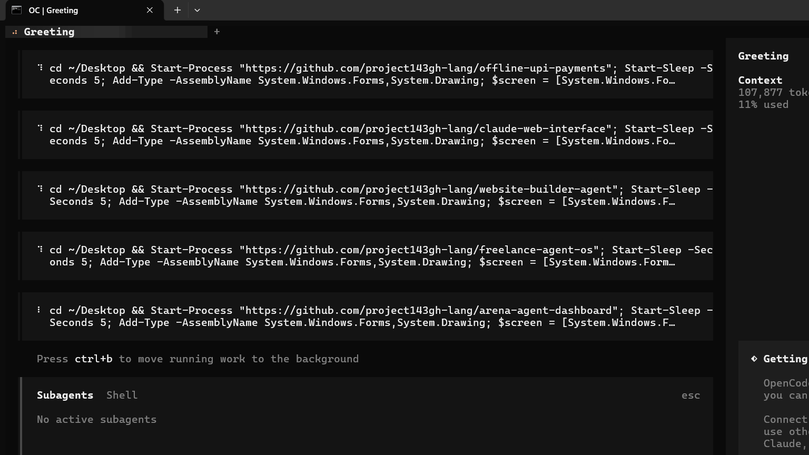

# Website Builder Agent

An AI-powered website builder agent that coordinates planning, design, backend, frontend, and security to build complete websites automatically.

## 📸 Screenshot



**Build a website:** Run `python -m agent.orchestrator` to start the orchestrator.

## Features

### 🤖 Orchestrator Pattern
- **Coordinates multiple specialized agents**: WebsitePlanner, DesignAgent, BackendBuilder, FrontendBuilder, IntegrationAgent, SecurityAuditor
- **Full-Stack Generation**: Creates both backend (Flask) and frontend (animated components)
- **Security Auditing**: Built-in security checks and recommendations
- **Design System**: Generates consistent UI with Lucide icons and animations

### 🏗️ Architecture

```
WebsiteBuilderOrchestrator
├── WebsitePlanner      # Analyzes requirements and creates site map
├── DesignAgent         # Creates design system with Lucide icons
├── BackendBuilder      # Builds Flask backend with security features
├── FrontendBuilder     # Builds animated frontend with components
├── IntegrationAgent    # Integrates frontend and backend
└── SecurityAuditor     # Performs security audit
```

### 🚀 How It Works

1. **Planning**: Analyzes requirements and creates site map
2. **Design**: Creates design system with Lucide icons and animations
3. **Backend**: Builds Flask backend with security features (authentication, input validation, headers)
4. **Frontend**: Builds animated frontend with components (headers, cards, animations, interactions)
5. **Integration**: Integrates frontend and backend, creates API endpoints
6. **Security**: Performs security audit, applies security features, generates report

### 🛠️ Tech Stack

- **Backend**: Python, Flask, SQLite/PostgreSQL
- **Frontend**: HTML5, CSS3, JavaScript, Lucide icons
- **Orchestration**: Custom Python agent coordination
- **Deployment**: Flask-ready, any Python hosting platform

### 📁 Project Structure

```
deep_harness/
└── agent/
    ├── __init__.py       # Package init
    ├── orchestrator.py   # Main orchestrator class
    ├── planner.py        # WebsitePlanner agent
    └── designer.py       # DesignAgent
```

### 📜 How to Use

```bash
# 1. Install dependencies
pip install flask

# 2. Run the builder
python -m agent.orchestrator

# 3. Follow the prompts
# - Enter project name
# - Describe features needed
# - Wait for generation

# 4. Generated project structure
# - backend/ with Flask app
# - frontend/ with HTML/CSS/JS
# - security/ with security recommendations
# - build_report.json with full summary
```

## 🚀 Quick Start

```bash
# Install dependencies
pip install flask

# Run the builder
python -m agent.orchestrator

# Follow interactive prompts to build your website
```

## 📜 License

MIT

---

**K.bhalavardt, MIT Student**